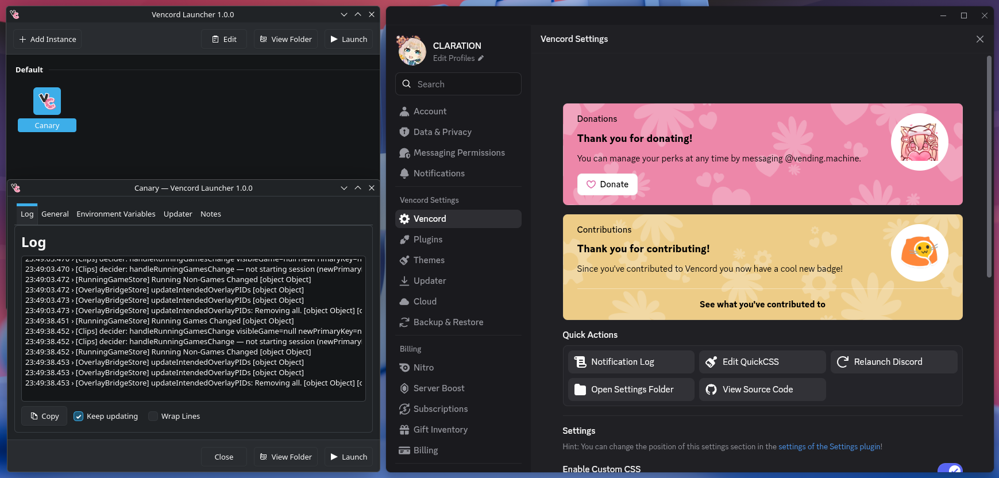

# Venject

[](https://github.com/claration/venject/releases)
[](https://github.com/claration/venject/releases)
[](https://github.com/claration/venject/blob/main/LICENSE)
[](https://github.com/sponsors/claration)

Launch Discord with [Vencord](https://github.com/Vendicated/Vencord) automatically installed!



## Download

Visit [releases](https://github.com/claration/venject/releases) and get the latest version for your computer.

## Building

### Linux Prerequisites

- qt, cmake, make, and a compiler

### Windows Prerequisites

- [msys2](https://www.msys2.org/)
- qt, make, cmake, a compiler from msys2

### Build

```
make build
```

## Sponsors

| Thanks to all my [sponsors](https://github.com/sponsors/claration)!! |
|:-:|
|  |
| _**"samara is cute" - Vendicated**_ |

## Acknowledgements

- [CLARATION](https://github.com/claration) – The maker.
- [Miyu](https://github.com/Instellate) – Windows support & QT stuff.
- [Megumin](https://github.com/MeguminSama/Electron-Hook) – Injection references.


## License

This project is licensed under the GPL-3.0 license. You can see the full details of the license [here](https://github.com/claration/venject/blob/main/LICENSE). 

By contributing to this project, you agree to license your code under the GPL-3.0 license as well (including agreeing to license exceptions), ensuring that your work, like all other contributions, remains freely accessible and open.
